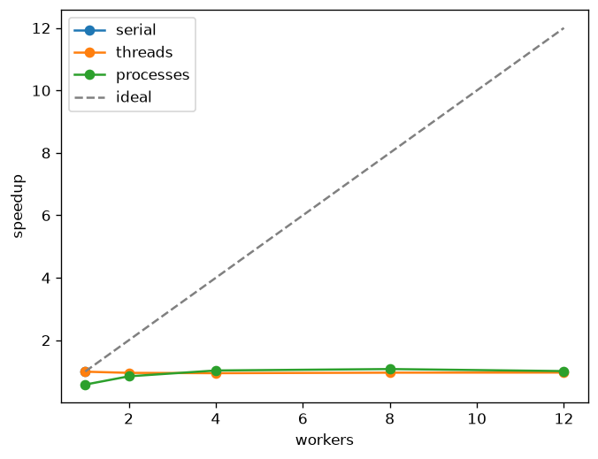
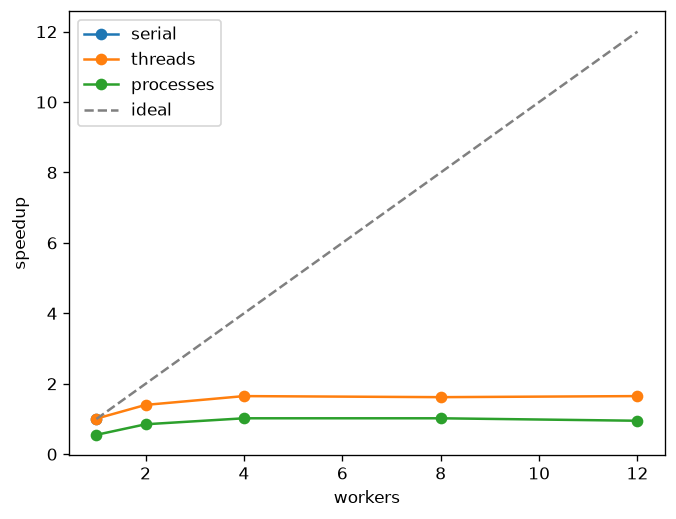

# findex — lab 5

Parallel index build on 8 `*.txt` files in `src/resources`. Measured on a 13th Gen Intel Core i5-13420H, 12 cores. Each cell is one warmup run, thrown away, then 3 runs. The table is the median. Wall time is `perf_counter` around `build_all`. CPU time for threads is the parent `process_time`. For processes it is that plus the CPU time each worker returns. Peak RSS is the parent's `WorkingSetSize`, sampled during that cell. Speedup is the serial median wall for that interpreter, divided by the cell.

`EXECUTOR = "processes"` in `index.py`. On the GIL build the best cell is 8 processes.

`uv run python -m findex.bench` on Python 3.12 (`sys._is_gil_enabled` is absent; the GIL is on). The same module on 3.13.15 free-threaded prints `sys._is_gil_enabled() False`.

## GIL on (Python 3.12)

| Executor | Workers | Wall (s) | CPU (s) | Peak RSS | Merge (s) | Speedup |
|---|---|---|---|---|---|---|
| serial | 1 | 1.029 | 0.969 | 80.9 MiB | 0.041 | 1.00× |
| threads | 1 | 1.036 | 1.000 | 84.1 MiB | 0.041 | 0.99× |
| threads | 2 | 1.077 | 1.047 | 91.5 MiB | 0.087 | 0.96× |
| threads | 4 | 1.089 | 1.062 | 91.7 MiB | 0.083 | 0.95× |
| threads | 8 | 1.070 | 1.047 | 93.8 MiB | 0.079 | 0.96× |
| threads | 12 | 1.066 | 1.062 | 96.3 MiB | 0.078 | 0.97× |
| processes | 1 | 1.773 | 1.312 | 98.8 MiB | 0.036 | 0.58× |
| processes | 2 | 1.218 | 1.375 | 96.7 MiB | 0.110 | 0.85× |
| processes | 4 | 0.998 | 1.406 | 96.0 MiB | 0.106 | 1.03× |
| processes | 8 | 0.955 | 1.594 | 95.4 MiB | 0.112 | 1.08× |
| processes | 12 | 1.017 | 1.688 | 94.3 MiB | 0.113 | 1.01× |

## Free-threaded 3.13t — `sys._is_gil_enabled()` is `False`

| Executor | Workers | Wall (s) | CPU (s) | Peak RSS | Merge (s) | Speedup |
|---|---|---|---|---|---|---|
| serial | 1 | 1.168 | 1.109 | 108.1 MiB | 0.062 | 1.00× |
| threads | 1 | 1.153 | 1.125 | 187.2 MiB | 0.066 | 1.01× |
| threads | 2 | 0.837 | 1.156 | 217.5 MiB | 0.074 | 1.40× |
| threads | 4 | 0.706 | 1.328 | 232.7 MiB | 0.078 | 1.65× |
| threads | 8 | 0.722 | 1.453 | 239.7 MiB | 0.085 | 1.62× |
| threads | 12 | 0.707 | 1.344 | 247.2 MiB | 0.079 | 1.65× |
| processes | 1 | 2.130 | 1.562 | 164.8 MiB | 0.076 | 0.55× |
| processes | 2 | 1.377 | 1.672 | 183.5 MiB | 0.087 | 0.85× |
| processes | 4 | 1.148 | 1.859 | 171.8 MiB | 0.086 | 1.02× |
| processes | 8 | 1.147 | 2.078 | 169.6 MiB | 0.092 | 1.02× |
| processes | 12 | 1.230 | 2.203 | 172.7 MiB | 0.094 | 0.95× |

The free-threaded run has no matplotlib wheel here, so this PNG was drawn from the medians above.

## Why the curves look like this

Indexing these books is about one second of Python: read the file, tokenize, count, store positions. With the GIL, one thread runs that bytecode. The others wait on the lock, about every 5 ms. Adding threads does not add cores. The threads rows stay at 0.95–0.99×. CPU time stays next to wall time: one core is busy, and the clock matches it. A few hundredths are lost to switching.

A process has its own interpreter and its own GIL, so the tokenize loops really overlap. The best cell on this machine is 8 processes, 0.955 s, 1.08×. One process is 1.773 s, which is slower than serial. Spawn starts a fresh interpreter, and the partial index comes back through pickle, before a second core has anything to do. At 8 workers the CPU time is 1.594 s against 0.955 s of wall. The extra CPU is the workers overlapping, plus the parent pickling paths in and partial indexes out. Parent RSS stays near 95 MiB across the process rows. The copies live in the children and never appear in that column.

There are 8 files. A worker count of 12 still launches 12 processes; four of them get an empty slice. Merge is 0.041 s in the serial run, 4% of the 1.029 s wall. If that were the only serial part, Amdahl's limit would be about 25×, and about 6× at 8 cores (`1 / (0.04 + 0.96/8)`). The measured 1.08× is the startup and the pickle, on a job this short. Merge itself does not shrink as workers are added. It sits around 0.04–0.11 s and is visible as a flat serial tail. It is not yet the thing that stops the curve. The curve is already flat because the parallel piece is only a second long.

On 3.13.15 free-threaded, `sys._is_gil_enabled()` is false and the same thread pool reaches 1.65× (0.706 s at 4 workers). A single thread is slower than on 3.12 (1.168 s against 1.029 s). Processes on 3.13t stay near 1.0×. The pickle tax is still there, and threads are no longer stuck behind one lock, so threads win.

Two threads each doing `shared += 1` a million times printed `2000000` on 3.12 and `1060218` on 3.13t. With a `Lock`, both printed `2000000`. `+=` is a load, an add, and a store. A thread switch, or a second core, between the load and the store writes an old total back. The GIL run happened to lose nothing this time. That does not make the update atomic. Free-threaded Python runs both updates at once, and the lost increments show up. The index does not share that counter. Each `build_partial` fills its own dicts. `merge` runs in the parent after the pool returns.

Reading the corpus files, repeated to 60 reads, took 0.075 s in one thread and 0.070 s with 8 threads on 3.12. The pages were already cached, and what remains is decoding bytes into Python strings, which holds the GIL. On 3.13t the same reads took 0.057 s and 0.019 s. The threads overlap the decode once nothing is waiting on the lock.

`uv run python src/main.py` builds with `EXECUTOR` and `WORKERS`, then runs the ranking demo.
